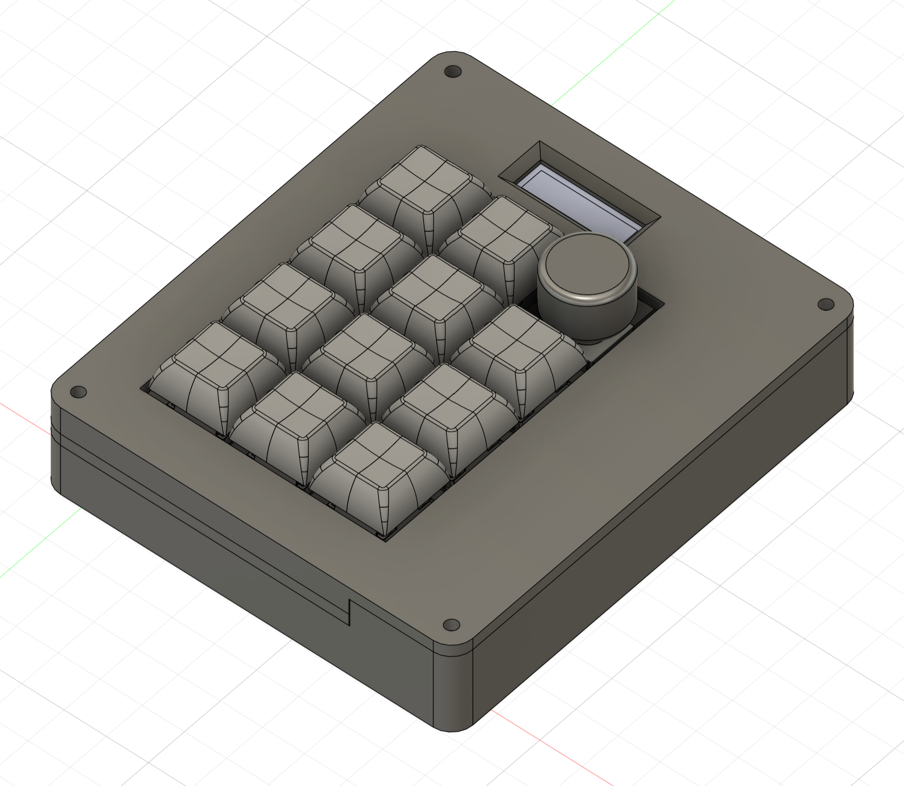
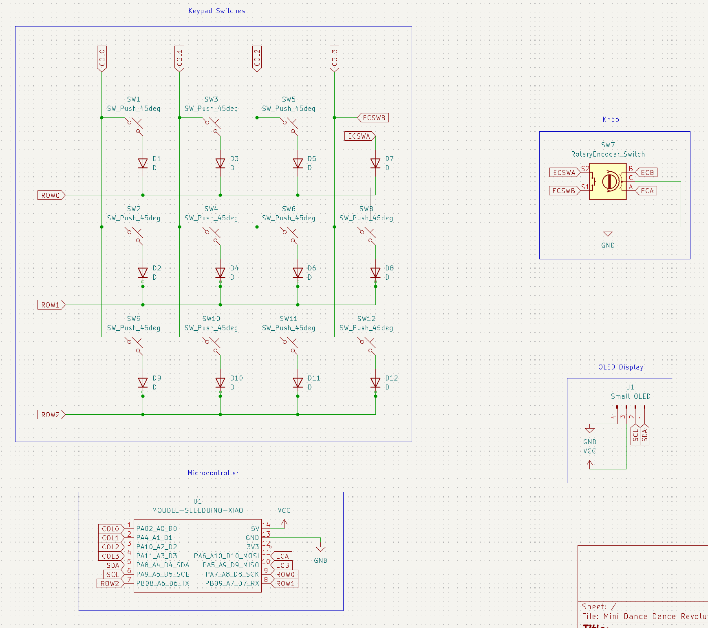
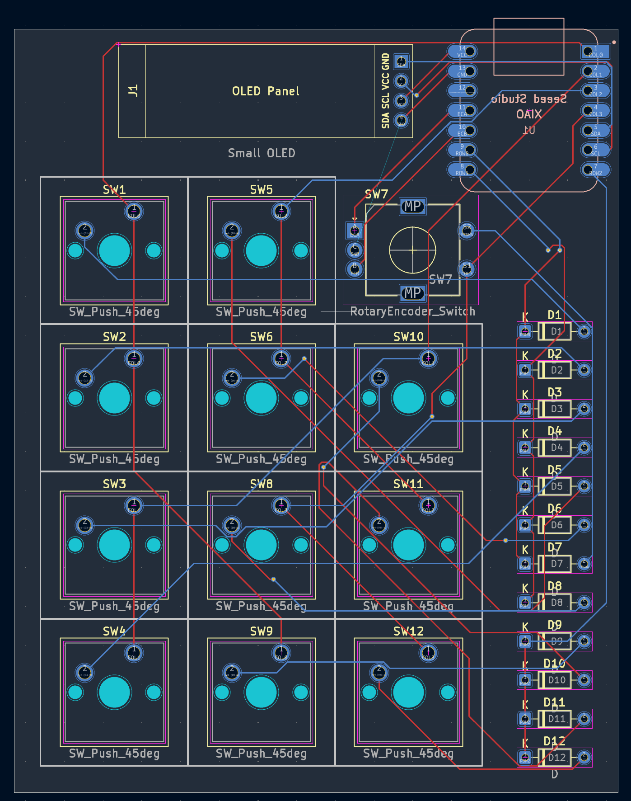
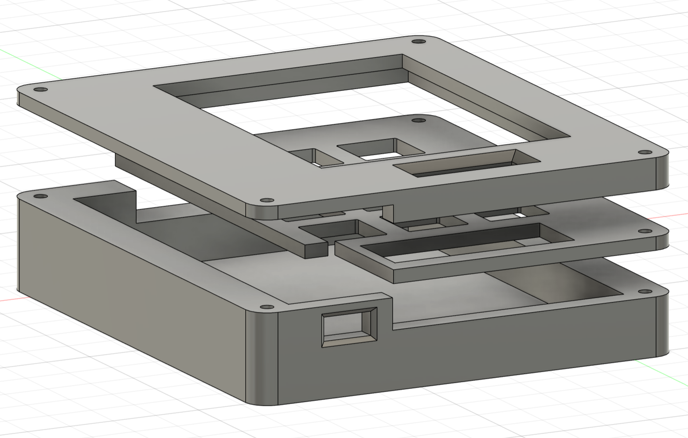

# DanceDanceRevolutionPad
This is a simple keypad that I made for Dance Dance Revolution similar games, like Friday Night Funkin' and Lightner's Live in Deltarune. It has a small 128x64 OLED display, 11 keys, and a knob for changing the keybinds.

# PCB

# Case
The case consists of three parts: the base, the top plate (to hold the switches/PCB to the case), and the cover plate (to cover all the components and make it look nicer).

The parts should fit on top of each other and can be held together with four M3x5mx4mm heatset inserts and M3x16mm screws.
